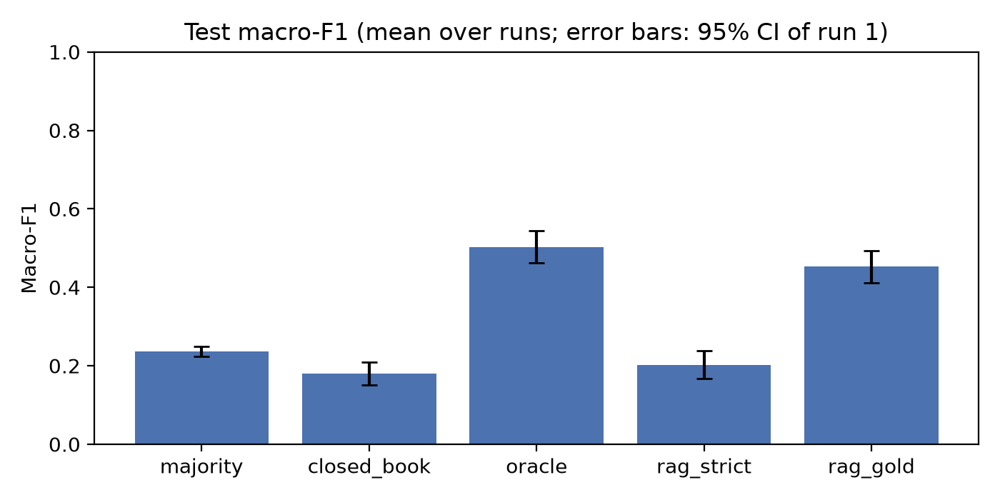
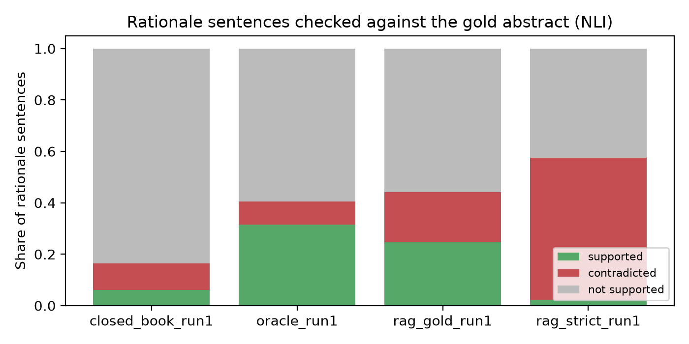

# 4. Evaluation, results and hallucination analysis

*Author: Guman Singh Rajput (Member 4).*

## 4.1 Protocol

All systems were frozen at tag `v1.0-test-results` (commit `e860c15`, the Phase 3 merge commit;
tag created 2026-11-22) and run once on the official 500-question test set. The analysis plan
was posted before the run
([issue #3](https://github.com/AnandPandey/biomedical-qa-rag/issues/3#issuecomment-7066870888)).
Primary metrics: accuracy and macro-F1 with 95 % bootstrap confidence intervals (10,000
resamples, seed 0). The plan declared four paired comparisons, an exact McNemar test with Holm
correction, and paired-bootstrap CIs of the macro-F1 difference.

**What was and was not done, relative to the pre-declared plan.** The plan called for the
classifier with 5 seeds and three runs of each LLM system. What exists is a single run (run 1) of
majority, closed_book, oracle, rag_strict and rag_gold. The classifier was **not** run on the test
set (its five checkpoints were not available), and runs 2 and 3 of the LLM systems were not done.
Consequences: every "± std" in the table is 0.000 because it is computed over one run, not
because the runs agree; the fourth comparison (classifier versus rag_strict) could not be made;
and the Holm correction below is applied over the three comparisons that exist, not over four.
The LLM runs were made on Google Colab and Kaggle T4 GPUs with the pinned library versions listed
in `results/test_run_log.md`, which also records every incident.

## 4.2 Main results

Test set, n = 500 (276 yes, 169 no, 55 maybe). Source: `results/tables/main_results.md`.

| System | Runs | Accuracy | Macro-F1 | Macro-F1 95 % CI (run 1) | F1 yes | F1 no | F1 maybe |
|---|---|---|---|---|---|---|---|
| majority | 1 | 0.552 | 0.237 | [0.225, 0.248] | 0.711 | 0.000 | 0.000 |
| closed_book | 1 | 0.214 | 0.180 | [0.152, 0.210] | 0.330 | 0.022 | 0.189 |
| rag_strict | 1 | 0.198 | 0.203 | [0.167, 0.238] | 0.182 | 0.242 | 0.184 |
| rag_gold | 1 | 0.510 | 0.452 | [0.412, 0.493] | 0.698 | 0.466 | 0.194 |
| oracle | 1 | 0.588 | 0.503 | [0.462, 0.543] | 0.780 | 0.532 | 0.196 |

Both closed_book and rag_strict are below the majority baseline in accuracy (0.214 and 0.198
versus 0.552). The closed-book model answers "maybe" for most questions (recall of "maybe" 0.745,
recall of "no" 0.012). No system tops the oracle upper bound; rag_gold comes closest (0.452
versus 0.503 macro-F1). No system had a parse failure. The classifier is absent (see 4.1).

## 4.3 Significance

Source: `results/tables/significance.md` (run 1 of each system, paired on the same 500
questions; Holm correction over the three comparisons that could be made).

| Comparison (run 1) | Δ macro-F1 | 95 % CI | Only A correct | Only B correct | McNemar p | Holm-adjusted p |
|---|---|---|---|---|---|---|
| rag_strict vs closed_book | +0.022 | [-0.020, +0.064] | 60 | 68 | 0.5363 | 0.5363 |
| rag_gold vs closed_book | +0.272 | [+0.224, +0.319] | 190 | 42 | < 0.0001 | < 0.0001 |
| oracle vs rag_strict | +0.300 | [+0.249, +0.353] | 244 | 49 | < 0.0001 | < 0.0001 |

- **rag_strict vs closed_book (the main hypothesis): inconclusive.** The macro-F1 difference
  (+0.022) has a CI that includes 0, and the McNemar test is not significant (p = 0.54). On the
  questions where only one system is correct, closed_book is correct slightly more often (68
  versus 60). We find no evidence that retrieving from a corpus that excludes the question's own
  article helps this model.
- **rag_gold vs closed_book: rag_gold is clearly better** (Δ macro-F1 +0.272, CI excludes 0,
  p < 0.0001). This should not be read as a RAG benefit in general: in the gold corpus the
  question's own article is retrieved at rank 1 for 363 of 500 questions (72.6 %), so rag_gold
  largely receives the oracle's evidence (see 4.6).
- **oracle vs rag_strict: oracle is much better** (Δ +0.300, CI excludes 0, p < 0.0001).
- **classifier vs rag_strict: not made**, because no classifier test predictions exist.

## 4.4 Hallucination analysis

Validation on dev: 160 rationale sentences were labelled twice. **Deviation from the
pre-declared plan:** both passes were done by an AI assistant (Claude) in two separate runs, not
by two human team members (see `results/annotation/PROVENANCE.md`). Each pass followed
`docs/annotation-guideline.md` and was blind to every NLI output and to the other pass. The two
passes come from the same model, so they are not independent raters: the agreement between them
measures the model's consistency, not inter-human agreement, and any NLI-versus-adjudicated
figure is not a validation against human annotation. Kappa between the two AI passes: 0.618
(accuracy 0.8125 on 160 items). NLI checker versus the adjudicated labels: kappa 0.133, accuracy
0.45 (source: `results/annotation/agreement.json`). The checker rarely labels a sentence
supported when the adjudicated label says supported (recall 0.24, precision 0.89) and never
recovers the 3 contradicted sentences. **Because this kappa is below the pre-declared threshold
of 0.40, the NLI-based hallucination numbers below are unreliable and must be read with that
warning.**

Source: `results/tables/hallucination.md` and `results/claims/summary_test.json` (run 1 of each
LLM system; claims are rationale sentences of at least four words). **Read these numbers with the
warning above: the checker's kappa against our labels was 0.133.**

| System | Claims | Per answer | Supported by evidence shown | Supported by gold abstract | Contradicted by gold abstract | Answers with a fabricated citation |
|---|---|---|---|---|---|---|
| closed_book | 894 | 1.79 | n/a (no evidence shown) | 0.060 | 0.104 | 0.000 |
| oracle | 883 | 1.77 | 0.296 | 0.316 | 0.088 | 0.000 |
| rag_gold | 909 | 1.82 | 0.259 | 0.246 | 0.196 | 0.002 |
| rag_strict | 1014 | 2.03 | 0.147 | 0.023 | 0.552 | 0.002 |

The fabricated-citation rate is very small (one answer each for rag_strict and rag_gold, none for
closed_book and oracle). The large "contradicted by the gold abstract" share for rag_strict
(0.552) is probably an artefact: the strict corpus never contains the question's own article, so
the model writes about a different study, and the NLI model tends to label sentences about an
unrelated study as contradictions of the gold abstract. We therefore do **not** read it as
evidence that strict RAG hallucinates more. Because of the checker's low agreement with our
labels, we draw no conclusion about hallucination from these shares beyond the near-absence of
fabricated citations.

## 4.5 Discussion

**Does retrieval help?** With the strict corpus, the setting that excludes the question's own
article, we find no evidence that it does: rag_strict and closed_book are statistically
indistinguishable (Δ macro-F1 +0.022, CI [-0.020, +0.064], McNemar p = 0.54), and both are below
the majority baseline in accuracy. With the gold corpus rag_gold is far better than closed_book,
but that gain comes mostly from retrieving the question's own abstract (363 of 500 questions),
which is the oracle condition in disguise. In 364 of 500 cases the rag_gold and oracle answers
are identical.

**How close is strict RAG to the oracle?** Far: macro-F1 0.203 versus 0.503 (Δ +0.300, CI
[+0.249, +0.353]). The gap is mainly the evidence, not the model: when the right abstract is in
the prompt the same model reaches 0.588 accuracy.

**Unsupported claims.** Our NLI checker agreed poorly with our own labels (kappa 0.133), so we
cannot say whether retrieval reduces unsupported rationale sentences. Fabricated citations are
essentially absent in all systems.

**Classifier.** Not compared, because no classifier test predictions were produced.

**Overall.** The pre-declared main hypothesis (rag_strict better than closed_book) is not
supported by these data, and the comparison is inconclusive rather than negative: it rests on a
single run per system and one LLM.

## 4.6 Limitations

- Dev-based model selection; one LLM; possible training-data contamination; title-derived
  questions make own-article retrieval easy; NLI checker accuracy (Section 4.4).
- Single run per system and no classifier result (see 4.1); the pre-declared Holm correction over
  four comparisons became three. No standard deviation over runs or seeds can be reported.
- Strict retrieval used k = 1 chosen on dev; with k = 1 and BM25 the retrieved abstract is often
  unrelated, which limits what rag_strict can show.
- The gold corpus contains the question's own article; rag_gold retrieves it at rank 1 for 363 of
  500 questions (rag_strict: 0 of 500, by construction), so rag_gold is not an independent test of
  retrieval.
- The NLI checker was validated against 160 labelled dev sentences, but the labels came from an AI
  assistant, not from human annotators (see 4.4), and its kappa (0.133) was below the 0.40
  threshold, so the hallucination shares are unreliable.
- Several LLM answers were served from the response cache because identical prompts occur across
  systems (log line 47 of `results/test_run_log.md`); the cache returns the same text as a fresh
  greedy generation.
- The LLM runs were made across two sessions (Colab and Kaggle) after a Colab GPU limit; the setup
  and pinned versions were the same and no code or configuration was changed.
